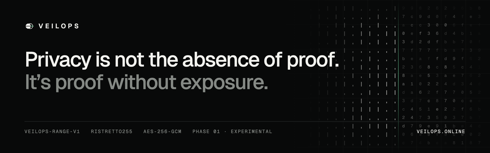
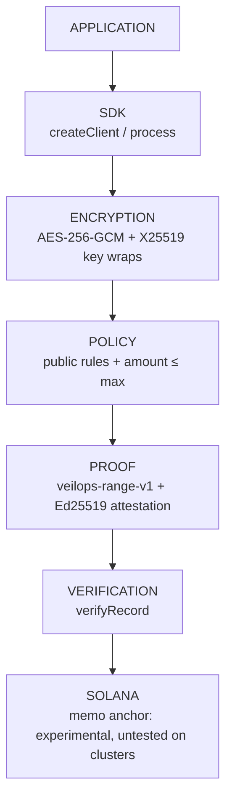

# VEILOPS

**Privacy is not the absence of proof. It's proof without exposure.**

Privacy infrastructure for programmable financial operations, cryptographic proofs and selective disclosure.

[veilops.tech](https://veilops.tech) · [X @Veilops_Tech](https://x.com/Veilops_Tech) · [Verify it yourself](https://veilops.tech/trust) · [Main repository](https://github.com/veilops-protocol/veilops) · [Docs](https://github.com/veilops-protocol/veilops/tree/main/docs) · [Security](https://github.com/veilops-protocol/.github/blob/main/SECURITY.md)

> **Experimental, Phase 01.** Real cryptography, **not audited**. Latest release: [v0.2.0](https://github.com/veilops-protocol/veilops/releases/latest): zero-knowledge proofs **verified on-chain** by a Solana program on devnet. No npm packages, no mainnet deployment.

## Verify, don't trust

- **Reproducible build:** `bash scripts/reproduce.sh` produces byte-identical package tarballs. Compare them with the release `SHA256SUMS`.
- **Two implementations:** reference test vectors are checked by the TypeScript code and by a separate standard-library Python verifier, which is itself checked against the RFC 9496 and RFC 8032 vectors.
- **Build provenance:** `gh attestation verify <file> --repo veilops-protocol/veilops`
- **Signed history:** commits and tags are SSH-signed with a published maintainer key, and `main` requires signed commits.
- **On-chain verification (devnet):** program [`4fWHkQi8…VexTZ`](https://explorer.solana.com/address/4fWHkQi8HgWPvw5fS4vudFGn6u6eZvdRKwfQqBgVexTZ?cluster=devnet) verifies the range proofs inside Solana. 3 proofs were verified and 2 forgeries rejected on-chain. The deployed binary matches the reproducible build.
- **Privacy scope:** amounts and operation details are hidden. Sender, timing and asset are **public** today; the planned designs are listed on the [trust page](https://veilops.tech/trust).
- **Independent review:** not done yet. The scope is in [docs/audit-scope.md](https://github.com/veilops-protocol/veilops/blob/main/docs/audit-scope.md).

Full guide: [VERIFY.md](https://github.com/veilops-protocol/veilops/blob/main/VERIFY.md).

---

## Mission

Make financial operations verifiable without making them public. Organizations should be able to prove that a payout respected its policy, that a record has not been altered, and who published it, while the amount and the recipient stay confidential and are disclosed only to the parties who need them.

## Protocol overview

An operator processes an operation locally with the VEILOPS SDK and obtains three artifacts:

| Artifact | Who sees it | Contents |
| --- | --- | --- |
| **Public record** | Anyone | Pedersen commitment to the amount, zero-knowledge range proof that `0 ≤ amount ≤ policy limit`, public metadata, Ed25519 operator signature |
| **Encrypted envelope** | Owner and authorized viewers | AES-256-GCM payload (name, recipient, amount, memo); data key wrapped per viewer with X25519 + HKDF-SHA256 |
| **Commitment opening** | Whoever the operator chooses | `(value, blinding)` that proves the exact amount behind the public commitment |

Proof system `veilops-range-v1`: `C = v·G + r·H` on ristretto255, with `H` from RFC 9380 hash-to-curve, and two bit-decomposition range proofs (CDS OR-proofs, Fiat–Shamir over SHA-512) on `C` and on `max·G − C`. Zero knowledge in the random-oracle model, no trusted setup, O(n) proof size. Not succinct, not audited.

What stays public: category, asset, mode, timestamps, the policy limit, the commitment, the envelope digest, and in `amount-only` mode the recipient. VEILOPS makes no anonymity claims.

## Architecture

## Core modules

| Module | Status |
| --- | --- |
| `@veilops/shared`: types, canonical JSON, identifiers | Implemented |
| `@veilops/encryption`: envelopes and selective disclosure | Implemented, not reviewed |
| `@veilops/policy-engine`: public and confidential rules | Implemented |
| `@veilops/proof-engine`: range proofs and attestation | Range proofs experimental; attestation implemented |
| `@veilops/sdk`: five-stage lifecycle | Implemented |
| `@veilops/solana-adapter`: SPL Memo anchor builder | Experimental; never sends; untested on devnet/mainnet |
| Token-2022 confidential transfers | Planned |
| On-chain program | Planned |

## Technology stack

- TypeScript (strict), ES modules, npm workspaces
- `@noble/curves` 2.0.1 (ristretto255, Ed25519, X25519), `@noble/hashes` 2.0.1 (SHA-2, HKDF), WebCrypto AES-256-GCM
- vitest (31 tests: unit, integration, security), ESLint 9 + typescript-eslint
- Next.js 16 + React 19, Tailwind CSS, Framer Motion for veilops.tech
- Solana: SPL Memo program (experimental anchor format)

## Repositories

| Repository | Description | Status |
| --- | --- | --- |
| [`veilops`](https://github.com/veilops-protocol/veilops) | Monorepo and source of truth: packages, tests, docs, website | Active, experimental |
| [`veilops-sdk`](https://github.com/veilops-protocol/veilops-sdk) | Read-only mirror of `packages/sdk` | Mirror, experimental |
| [`veilops-proof-engine`](https://github.com/veilops-protocol/veilops-proof-engine) | Read-only mirror of `packages/proof-engine` | Mirror, experimental, not audited |
| [`veilops-explorer`](https://github.com/veilops-protocol/veilops-explorer) | Read-only mirror of `apps/website`, which hosts the sample explorer | Mirror, in development |
| [`veilops-docs`](https://github.com/veilops-protocol/veilops-docs) | Read-only mirror of `docs/` | Mirror |

During Phase 01 all development happens in `veilops`; the other repositories are subtree mirrors. Please open issues and pull requests on `veilops`.

## Developer documentation

- [Architecture](https://github.com/veilops-protocol/veilops/blob/main/docs/architecture.md)
- [Protocol and record format](https://github.com/veilops-protocol/veilops/blob/main/docs/protocol.md)
- [Cryptography](https://github.com/veilops-protocol/veilops/blob/main/docs/cryptography.md)
- [Security model](https://github.com/veilops-protocol/veilops/blob/main/docs/security.md)
- [Developer guide](https://github.com/veilops-protocol/veilops/blob/main/docs/developer-guide.md)

## Security

Report vulnerabilities privately through GitHub Security Advisories on the affected repository. Never open a public issue for a security problem. There is no bug bounty. See the [security policy](https://github.com/veilops-protocol/.github/blob/main/SECURITY.md).

## Contributing

Reviews of the cryptography and the threat model are especially welcome. Read the [contribution guidelines](https://github.com/veilops-protocol/.github/blob/main/CONTRIBUTING.md) and the [Code of Conduct](https://github.com/veilops-protocol/.github/blob/main/CODE_OF_CONDUCT.md).

## Roadmap

| Phase | Status |
| --- | --- |
| 01 Foundation: packages, proofs, encryption, SDK, tests, docs, website | In progress (core packages done) |
| 02 Proof Infrastructure: compact encoding, test vectors, succinct range proof evaluation | Planned |
| 03 Solana Integration: devnet anchoring, Token-2022 confidential transfers, on-chain program design | Planned |
| 04 Applications: explorer, treasury and payroll flows, auditor workflow | Planned |
| 05 Security & Ecosystem: external audit, published packages, releases | Planned |

Licensed under Apache-2.0.
